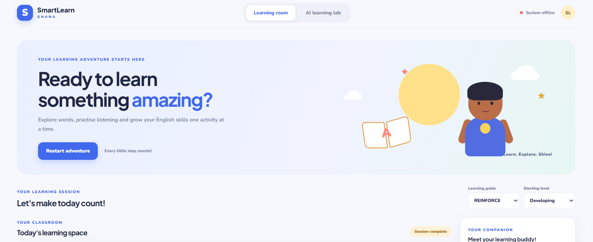

# SmartLearn Ghana
### A Mission-Based Reinforcement Learning System for Adaptive English Learning

## 1. Project Overview

SmartLearn Ghana is a reinforcement learning project designed to explore how intelligent agents can support adaptive English learning for primary-school children, particularly those in underserved communities in Ghana.

In communities where English is not commonly spoken outside the classroom, children may have limited opportunities to practise English communication. SmartLearn Ghana explores how an adaptive learning system could respond to a learner's changing needs by selecting learning activities based on their simulated performance, confidence, engagement and fatigue.

The project implements and compares four reinforcement learning algorithms: Deep Q-Network (DQN), REINFORCE, Proximal Policy Optimization (PPO) and Advantage Actor-Critic (A2C).

The agents interact with a custom simulated learning environment built with Gymnasium. A web-based interface allows users to observe the selected learning activities and the agent's interaction with the environment.

## 2. Problem Statement

Many primary-school children in underserved communities face challenges practising English outside formal classroom settings. Limited exposure to English can affect vocabulary development, listening comprehension, reading comprehension and sentence construction.

A conventional learning approach may not sufficiently adapt to differences in individual learning needs and progress.

SmartLearn Ghana explores the use of reinforcement learning to simulate an adaptive learning experience in which an agent selects activities based on the learner's current state and receives feedback from the environment.

## 3. Mission and Objectives

**Mission:** To explore how reinforcement learning can support more adaptive and accessible English-learning experiences for children in Ghana.

The main objectives are to:

- Develop a custom environment that simulates a child's English-learning journey.
- Implement a meaningful action and reward structure for adaptive learning.
- Train four reinforcement learning algorithms using TorchRL.
- Compare the performance of value-based and policy-based approaches.
- Examine how different agents balance learning progress, confidence, engagement and fatigue.
- Provide an interactive interface for observing agent behaviour.

## 4. System Architecture

SmartLearn Ghana consists of three main components:

**1. Reinforcement Learning Environment**

A custom Gymnasium environment simulates the learner's progress and responds to the activities selected by the agent.

**2. Training and Evaluation**

Four reinforcement learning algorithms are trained and evaluated in the same environment using different hyperparameter configurations.

**3. Web Interface and Inference API**

A Python API loads a trained agent and connects its decisions to a browser-based interface built with HTML, CSS and JavaScript.

The frontend communicates with the Python backend through API endpoints, allowing users to start learning sessions, observe agent decisions, view rewards and reset sessions.

## 5. SmartLearn Ghana Interface





## 6. Reinforcement Learning Environment

The custom environment is implemented in `environment/custom_env.py` using Gymnasium.

### 6.1 Observation Space

The agent receives an observation containing 11 values representing the simulated learner's current state:

| Observation | Description |
|---|---|
| Vocabulary mastery | Current vocabulary performance |
| Listening mastery | Current listening performance |
| Comprehension mastery | Reading and comprehension performance |
| Sentence-building mastery | Ability to construct sentences |
| Confidence | Simulated learner confidence |
| Engagement | Simulated learner engagement |
| Fatigue | Simulated learner fatigue |
| Difficulty | Current learning difficulty |
| Previous success | Outcome of the previous activity |
| Remaining time | Remaining episode time |
| Recent mistakes | Recent mistakes made during activities |

The observation values are normalised to support consistent agent input.

### 6.2 Action Space

The environment provides seven possible actions:

| Action | Learning activity |
|---|---|
| 0 | Vocabulary introduction |
| 1 | Listening practice |
| 2 | Local-language support scaffold |
| 3 | Word matching |
| 4 | Reading comprehension |
| 5 | Sentence building |
| 6 | Revision of the weakest skill |

Each action produces a state transition that can affect the learner's mastery, confidence, engagement, fatigue and learning difficulty.

### 6.3 Reward Structure

The reward function encourages learning progress while considering the learner's overall simulated experience.

The main reward components include:

- **Skill improvement:** Rewards increases in the four tracked English skills.
- **Successful activities:** Provides a positive reward when an activity is completed successfully.
- **Unsuccessful activities:** Applies a penalty when an activity is unsuccessful.
- **Confidence:** Encourages improvements in simulated learner confidence.
- **Engagement:** Rewards increased engagement.
- **Fatigue:** Penalises increases in fatigue.
- **Repeated activities:** Applies a penalty when the same action is repeatedly selected.

The reward structure is designed to encourage the agent to balance learning progress with the learner's engagement and well-being.

### 6.4 Initial States and Episode Termination

The environment supports four simulated learner profiles:

- Beginner
- Developing
- Intermediate
- Uneven skill profile

Each episode has a maximum of 20 steps. An episode can terminate when all four tracked skills reach the mastery threshold of 0.90 or when fatigue reaches the terminal threshold of 0.95. Episodes also end when the maximum step limit is reached.

All learner profiles and outcomes are generated by simulation rules rather than actual child assessment data.

## 7. Reinforcement Learning Algorithms

Four algorithms are implemented using TorchRL:

| Algorithm | Approach | Description |
|---|---|---|
| DQN | Value-based | Learns action values and selects actions based on estimated future returns. |
| REINFORCE | Policy-based | Updates its policy using returns from sampled episodes. |
| PPO | Policy-based | Uses a clipped policy objective to support more stable policy updates. |
| A2C | Actor-Critic | Uses an actor to select actions and a critic to estimate value. |

All four agents interact with the same custom environment to support a comparative evaluation.

## 8. Hyperparameter Experiments

Ten hyperparameter configurations were evaluated for each algorithm, resulting in 40 experimental configurations.

Each configuration was trained for 100 episodes.

The experiments explored different training settings, including learning rates, discount factors, network configurations and algorithm-specific parameters.

The aim was to investigate how different hyperparameter choices influence agent learning, stability and performance.

## 9. Independent Evaluation Results

The selected trained agents were evaluated using four simulated learner profiles and multiple random seeds.

The following table summarises the independent evaluation results:

| Agent | Average reward | Success rate | Mastery improvement |
|---|---:|---:|---:|
| DQN | 8.32 | 57.25% | 0.1079 |
| REINFORCE | 8.18 | 58.00% | 0.1083 |
| PPO | 10.00 | 49.00% | 0.1046 |
| A2C | 8.62 | 47.88% | 0.1046 |

### Key Findings

- PPO achieved the highest average reward among the evaluated agents.
- REINFORCE achieved the highest activity success rate and average mastery improvement.
- DQN demonstrated competitive performance across the evaluation measures.
- A higher average reward did not necessarily correspond to a higher success rate or greater mastery improvement.
- The agents showed a tendency to repeatedly select certain actions, particularly local-language support scaffolding.

These findings highlight the importance of evaluating reinforcement learning agents using multiple performance measures rather than relying exclusively on cumulative reward.

The results represent simulated experiments and should not be interpreted as evidence of measured improvements in actual children's English proficiency.

## 10. Technology Stack

**Backend and Reinforcement Learning**
- Python 3.11+
- PyTorch
- TorchRL
- Gymnasium
- NumPy
- Pandas

**Frontend**
- HTML5
- CSS3
- JavaScript

**Visualisation and Supporting Tools**
- Matplotlib
- Pygame
- TensorBoard
- Pytest

**Environment and Dependency Management**
- uv

## 11. Project Structure

```text
hikma_hamza_rl_summative/
│
├── environment/
│   ├── __init__.py
│   ├── custom_env.py
│   └── rendering.py
│
├── training/
│   ├── dqn_training.py
│   ├── reinforce_training.py
│   ├── ppo_training.py
│   └── a2c_training.py
│
├── evaluation/
│   ├── agent_loader.py
│   ├── analyze_results.py
│   └── results/
│
├── experiments/
│   ├── configs/
│   └── results/
│
├── inference/
│   └── api.py
│
├── frontend/
│   ├── index.html
│   ├── styles.css
│   ├── app.js
│   └── assets/
│
├── models/
│   ├── dqn/
│   ├── reinforce/
│   ├── ppo/
│   └── a2c/
│
├── tests/
├── logs/
├── assets/
├── reports/
│
├── main.py
├── play.py
├── pyproject.toml
├── uv.lock
└── README.md
```

## 12. Installation and Setup

### Prerequisites

- Python 3.11 or later
- uv package manager
- Git

### Clone the repository

```bash
git clone https://github.com/Hikma-codes/hikma_hamza_rl_summative.git

cd hikma_hamza_rl_summative
```

### Install project dependencies

```bash
uv sync
```

The `pyproject.toml` and `uv.lock` files manage the project's dependencies and environment.

### Run the application

Start the Python inference API:

```bash
uv run python -m inference.api
```

Open the following address in a browser:

```text
http://127.0.0.1:8000/
```

The application interface communicates with the Python backend to run learning sessions using the loaded trained agent.

## 13. API Endpoints

The inference API provides the following endpoints:

| Method | Endpoint | Purpose |
|---|---|---|
| GET | `/` | Serves the web application |
| GET | `/health` | Checks API availability |
| POST | `/session/start` | Starts a learning session |
| POST | `/session/step` | Executes an agent interaction |
| POST | `/session/reset` | Resets the learning session |

## 14. Limitations

SmartLearn Ghana is an experimental reinforcement learning simulation, not a deployed educational intervention.

Its main limitations include:

- Learner profiles and performance are simulated rather than collected from real children.
- The environment uses predefined rules to determine activity outcomes and learning progress.
- Agents may favour actions that produce favourable rewards without necessarily maximising educational progress.
- Repeated selection of particular activities indicates that the reward structure and learned policies require further refinement.
- The evaluation results cannot establish real-world learning effectiveness.

## 15. Future Improvements

Potential future improvements include:

- Testing the system with real learners through an appropriately designed and ethically approved pilot.
- Incorporating validated English-learning assessment methods.
- Improving the reward structure to reduce repetitive action selection.
- Exploring additional African-language support.
- Improving the simulation's visual and interactive capabilities.
- Investigating deployment on accessible devices such as school tablets.

## 16. Conclusion

SmartLearn Ghana demonstrates how reinforcement learning can be applied to a simulated adaptive English-learning environment.

By implementing and comparing DQN, REINFORCE, PPO and A2C, the project investigates how different learning algorithms make decisions under a shared reward structure.

The results demonstrate that agent performance involves more than maximising cumulative reward. Learning progress, activity success, engagement and fatigue must also be considered when evaluating an adaptive educational system.

SmartLearn Ghana provides a foundation for further exploration of reinforcement learning applications in accessible and context-aware educational technology.

## 17. References

[1] Mnih, V., et al. (2015). Human-level control through deep reinforcement learning. Nature, 518, 529–533. https://doi.org/10.1038/nature14236


[2] Williams, R. J. (1992). Simple statistical gradient-following algorithms for connectionist reinforcement learning. Machine Learning, 8, 229–256. https://doi.org/10.1007/BF00992696


[3] Schulman, J., et al. (2017). Proximal Policy Optimization Algorithms. arXiv:1707.06347. https://arxiv.org/abs/1707.06347


[4] Mnih, V., et al. (2016). Asynchronous Methods for Deep Reinforcement Learning. Proceedings of ICML, PMLR 48, 1928–1937. https://proceedings.mlr.press/v48/mniha16.html


[5] PyTorch Foundation. TorchRL documentation. https://pytorch.org/rl/


[6] Farama Foundation. Gymnasium documentation: Create a custom environment. https://gymnasium.farama.org/tutorials/gymnasium_basics/environment_creation/

---

**Project:** SmartLearn Ghana  
**Author:** Hikma Hamza  
**Project Type:** Mission-Based Reinforcement Learning
